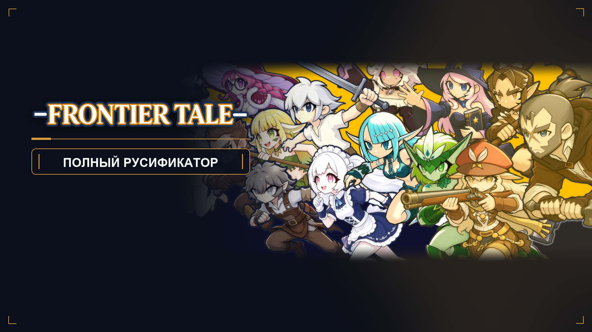
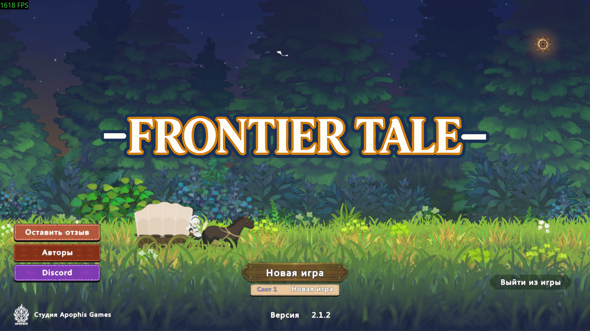

# Frontier Tale: Русификатор

Русский перевод текста и всех достижений для **Frontier Tale**.

**[Скачать FrontierTale-RU-v1.0.zip](https://github.com/neoru-droid/frontier-tale-ru/releases/latest)**

## Установка
1. Закройте игру, распакуйте архив и запустите `FrontierTale-RU-Setup.exe` -> **«Установить русификатор»** (в настройках игры оставьте язык **English**).
2. **Steam Deck / Linux:** распакуйте архив и запустите `sh install-steamdeck.sh` рядом с `.exe`.
3. Кнопка **«Вернуть оригинал»** удаляет перевод. После обновлений игры запустите установку повторно.

*(Окно SmartScreen на Windows: «Подробнее» -> «Выполнить в любом случае».)*

## Скриншоты

| Главное меню | Выбор сложности |
| :---: | :---: |
|  |  |

| Диалог | Инвентарь |
| :---: | :---: |
|  |  |

| Достижения | Установщик |
| :---: | :---: |
|  |  |

## Поддержать
- **[Чаевые через CloudTips (СБП / карта)](https://pay.cloudtips.ru/p/240b8760)**

Перевод сделан с нейросетью и вычитан в игре. Найдёте опечатку - пишите в [Issues](https://github.com/neoru-droid/frontier-tale-ru/issues), поправлю.

## Другие переводы
- [We March as One](https://github.com/neoru-droid/we-march-as-one-ru)
- [Zombies Aren't Real](https://github.com/neoru-droid/zombies-arent-real-ru)

Лицензия: [MIT](LICENSE)
