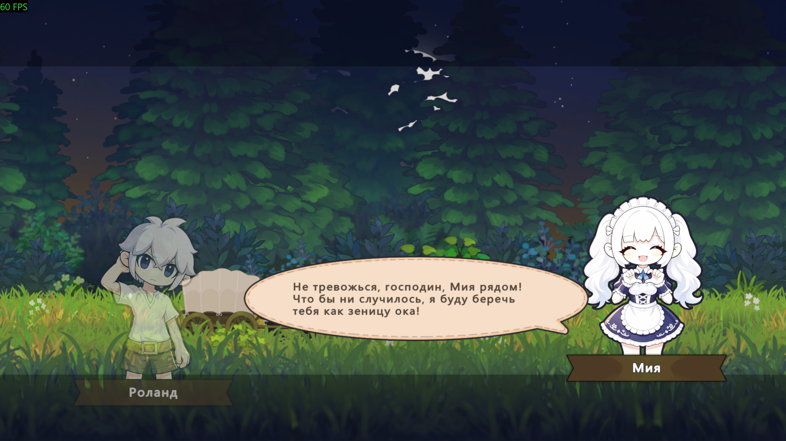
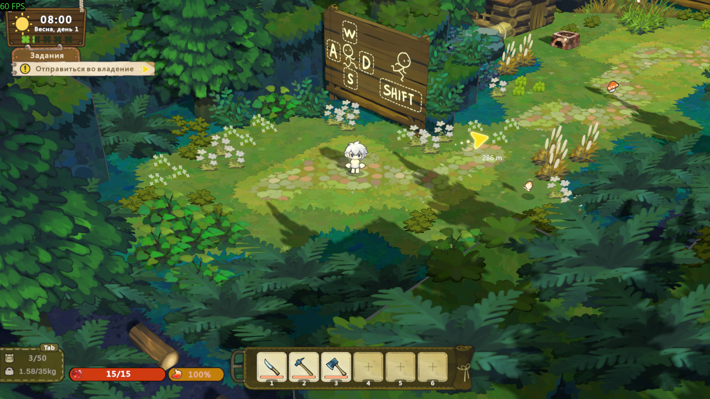

# Frontier Tale - Русификатор

Полный русский перевод **Frontier Tale** v1.3 под патч `2.1.7` (сборка Steam `26862122`, Windows и Steam Deck): сюжет, диалоги, предметы, рецепты, подписи мини-карты, экран модов и задания.

## Скачать
**[Скачать русификатор v1.3 (ZIP)](https://github.com/neoru-droid/frontier-tale-ru/releases/download/v1.3.0/FrontierTale-RU-v1.3.zip)** · [Как установить](#установка) · [Руководство в Steam](https://steamcommunity.com/sharedfiles/filedetails/?id=3840837132)

Проверено на **Frontier Tale 2.1.7** (сборка Steam `26862122`) для **Windows** и **Steam Deck / Linux**.

## Установка
1. Закройте игру, распакуйте архив и запустите `FrontierTale-RU-Setup.exe` -> **«Установить русификатор»** (в настройках игры оставьте язык **English**).
2. **Steam Deck / Linux:** распакуйте все файлы архива в одну папку и выполните `sh install-steamdeck.sh` рядом с `.exe`.
3. Кнопка **«Вернуть оригинал»** убирает перевод через тот же установщик. После обновлений игры запустите установку повторно.

*(Окно SmartScreen на Windows: «Подробнее» -> «Выполнить в любом случае».)*

## Скриншоты

Открыть игровые кадры

**Главное меню**

**Выбор сложности**

**Диалог**

**Инвентарь**

## История обновлений
- **[v1.3](https://github.com/neoru-droid/frontier-tale-ru/releases/tag/v1.3.0)** - обновление под патч `2.1.7` (сборка `26862122`): перевод экрана модов и Мастерской Steam, уточнённые описания построек и станков для материалов.
- **[v1.2](https://github.com/neoru-droid/frontier-tale-ru/releases/tag/v1.2.0)** - перевод для `2.1.5`: обновлены подписи мини-карты, описания жилищ и сообщения о восстановлении ресурсов.
- **[v1.1](https://github.com/neoru-droid/frontier-tale-ru/releases/tag/v1.1.0)** - адаптация под патч игры `2.1.0` и обновлённое окно установщика.
- **[v1.0](https://github.com/neoru-droid/frontier-tale-ru/releases/tag/v1.0.0)** - первый выпуск перевода текста для Windows и Steam Deck.

## Обратная связь

Перевод сделан нейросетью и проверен в игре. Найдёте опечатку или косяк - пишите в [Issues](https://github.com/neoru-droid/frontier-tale-ru/issues), поправлю.

[Все переводы автора в Steam](https://steamcommunity.com/id/cd-_-TiXo/myworkshopfiles/?section=guides) · [Все версии на GitHub](https://github.com/neoru-droid/frontier-tale-ru/releases)

Лицензия: [MIT](LICENSE)

Автор: `neoru-droid`
