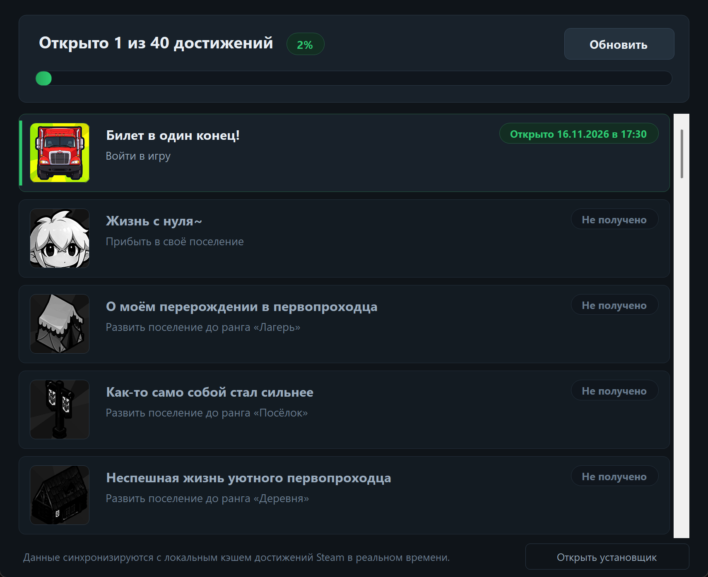

# Frontier Tale: Русификатор

Полный русский перевод **Frontier Tale** (`Steam AppID 4829780`): все **6 918** строк текста и все **40 достижений Steam**.

**[Скачать FrontierTale-RU-v1.0.zip](https://github.com/neoru-droid/frontier-tale-ru/releases/latest)**

## Что внутри
- **100% текста игры:** сюжет, диалоги спутников, предметы, оружие, крафт, постройки, книги и задания.
- **Все 40 достижений Steam:** русские уведомления + просмотр прогресса открытия прямо в установщике.
- **Чистый патч по ключам:** родной динамический шрифт без правки `.bundle` и баланса, совместимость с сохранениями и хотфиксами, откат в один клик.

## Установка
- **Windows:** закройте игру, распакуйте архив, запустите `FrontierTale-RU-Setup.exe` и нажмите **«Установить русификатор»** (в настройках игры оставьте язык **English**). *SmartScreen:* «Подробнее» -> «Выполнить в любом случае».
- **Steam Deck / Linux:** распакуйте архив и запустите `sh install-steamdeck.sh` рядом с `.exe`.
- **Удаление / патчи:** кнопка **«Вернуть оригинал»** восстанавливает чистые файлы из `ru_backup_orig`; после обновлений игры просто нажмите **«Установить русификатор»** повторно.

## Скриншоты

| Главное меню | Выбор сложности |
| :---: | :---: |
|  |  |

| Сюжетный диалог | Инвентарь и поселение |
| :---: | :---: |
|  |  |

| Достижения (40 из 40) | Установщик |
| :---: | :---: |
|  |  |

## Поддержать автора
Перевод бесплатный. Сказать спасибо можно чаевыми через **[CloudTips (СБП / карта)](https://pay.cloudtips.ru/p/240b8760)** или звездой репозиторию. О найденных опечатках пишите в [Issues](https://github.com/neoru-droid/frontier-tale-ru/issues).

Лицензия: [MIT](LICENSE) · Автор: [`neoru-droid`](https://github.com/neoru-droid) (файлов самой игры в репозитории нет).
